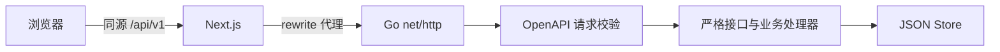

# AI Fullstack Lab

**契约驱动的 AI 自动化全栈开发工程：Next.js + Go + OpenAPI + Codex。**

本工程提供一条可执行的开发路径：将需求写成 Markdown，由不同职责的 Agent 完成设计、契约和前后端实现，再运行确定性的质量门禁与只读审查，产出可供开发者审阅的代码、测试证据和执行记录。

业务示例是一个任务看板，已实现任务创建、列表、状态更新、删除和文件持久化。工程同时提供“任务优先级”需求作为后续实践，用于验证新增字段如何贯穿接口、历史数据、前端交互与自动化测试。

## 阅读导航

[快速开始](#快速开始) · [架构与技术栈](#架构与技术栈) · [契约驱动对接](#契约驱动对接) · [Agent 开发流程](#agent-开发流程) · [Skill 与角色配置](#skill-与角色配置) · [质量门禁](#质量门禁) · [实施文档](#实施文档)

## 工程能力

| 能力 | 当前实现 |
|---|---|
| 前端应用 | 响应式任务看板，包含加载、空列表、请求失败和提交状态 |
| 后端服务 | 健康检查、任务 CRUD、请求校验、统一 JSON 错误响应、优雅关闭 |
| 自动接口对接 | 单一 OpenAPI 契约，生成 Go 类型、路由、严格接口和 TS 类型 |
| 本地开发 | 一个命令启动两端，协调代理地址，并在退出时清理服务进程 |
| AI 开发编排 | 分阶段 CLI 会话、结构化结果、进度记录、超时与失败停止 |
| 工程验收 | 契约漂移检查、静态分析、Go race 测试、生产构建、真实浏览器联调 |
| 交付配置 | 项目规则、3 个 Skill、5 个 Agent 角色、CI、Dockerfile 与 Compose |

## 快速开始

### 环境要求

| 工具 | 要求 | 用途 |
|---|---|---|
| Node.js | 22+；搭建验证使用 24 | 前端、依赖管理与工程脚本 |
| npm | 随 Node.js 安装 | 安装 workspace 依赖、执行项目命令 |
| Go | 1.25+ | API 服务、契约生成和后端测试 |
| Python | 3.9+ | Agent 编排与编排器测试，仅使用标准库 |
| Codex CLI | 使用支持本工程参数的版本；已核对 0.167.0 | 执行真实 AI 开发时需要已登录 |

普通开发和业务测试不需要模型认证。首次安装 npm 依赖、Go 模块和 Playwright 浏览器需要网络。开发进程管理脚本使用 POSIX 进程组，适用于 macOS / Linux。

### 安装并启动

从父仓库根目录执行；若已在本目录，可跳过第一行：

```bash
cd ai-fullstack-lab
npm ci
npm run dev
```

| 入口 | 默认值 |
|---|---|
| 前端页面 | <http://127.0.0.1:3000> |
| 后端健康检查 | <http://127.0.0.1:8080/api/v1/health> |
| 浏览器 API 入口 | 前端同源 `/api/v1/...` |
| 持久化文件 | `.var/tasks.json` |

在看板中创建任务，依次切换到“进行中”和“已完成”，刷新后数据仍保留。按 `Ctrl+C` 同时关闭前后端。

### 环境配置

```bash
# 调整两端端口
WEB_PORT=3200 API_PORT=8282 npm run dev

# 指定独立的数据文件
DATA_FILE=/tmp/agent-lab-tasks.json npm run dev
```

| 变量 | 作用范围 | 默认行为 |
|---|---|---|
| `WEB_PORT` | 根目录开发编排器 | 前端端口为 `3000` |
| `API_PORT` | 根目录开发编排器 | 后端端口为 `8080`，同步设置前端代理 |
| `DATA_FILE` | 开发编排器 / Go 服务 | 编排启动使用本目录 `.var/tasks.json` |
| `API_ORIGIN` | 单独启动或构建 Next.js | 后端地址为 `http://127.0.0.1:8080` |
| `ADDR` | 单独启动 Go | 监听地址为 `127.0.0.1:8080` |

`.env.example` 提供变量说明；根目录 `.env` 不会被开发编排器自动加载。使用 `npm run dev` 时，编排器根据 `API_PORT` 自动设置 `ADDR` 和 `API_ORIGIN`。单独启动 Go 时，默认数据路径相对进程工作目录；需要共享同一文件时请显式设置绝对路径。

## 架构与技术栈

工程包含业务运行链路和 AI 开发链路。模型只参与开发过程，任务看板的运行请求不依赖模型。



| 层次 | 技术 | 工程职责 |
|---|---|---|
| 前端 | Next.js App Router、React、TypeScript | 页面、交互与同源请求入口 |
| 后端 | Go `net/http`、oapi-codegen | 类型化 API、业务处理与 HTTP 服务生命周期 |
| 契约 | OpenAPI 3.0.3 | 请求、响应、状态码和字段约束的唯一来源 |
| 调用端 | openapi-typescript、openapi-fetch | 生成调用类型，约束路径、参数与响应使用 |
| 存储 | JSON 文件、mutex、临时文件替换 | 单进程持久化与失败写入保护 |
| AI 编排 | Codex CLI、Python、JSON Schema | 阶段调度、结构化结果与执行记录 |
| 验证 | Go 测试、ESLint、TypeScript、Playwright | 静态检查、业务测试与真实跨端联调 |

默认后端选择 Go。Rust 的 Axum / Serde / SQLx 替换路径以及 PostgreSQL 演进方案见[架构文档](docs/architecture.md)，当前工程尚未实现 Rust 后端或数据库存储。

### 项目结构

```text
.
├── apps/
│   ├── web/src/
│   │   ├── app/              页面、布局与样式
│   │   └── lib/              类型客户端与生成的 API 类型
│   └── api/
│       ├── cmd/server/       Go 服务启动入口
│       └── internal/
│           ├── api/          生成的类型、路由与严格接口
│           └── tasks/        业务处理器、存储与后端测试
├── contracts/openapi.yaml    API 契约源文件
├── scripts/                  开发、契约生成与 Agent 编排
├── .agents/skills/           项目级 Skills 与元数据
├── .codex/agents/            交互式 Agent 角色入口
├── .automation/
│   ├── roles/                阶段职责指令
│   └── result.schema.json    Agent 最终结果协议
├── specs/examples/           可执行需求示例
├── tests/                    E2E 与编排器测试
├── docs/                     架构、流程、实操与验证记录
├── .github/workflows/        独立仓库使用的质量门禁 CI
└── compose.yaml              前后端容器组合
```

## 契约驱动对接

`contracts/openapi.yaml` 是前后端共享的接口定义。修改接口时先更新契约，再生成双方代码，最后实现业务与调用端。

```bash
npm run generate         # 生成两端 API 代码
npm run contracts:check  # 临时重生成并比较，检查结果漂移
```

| 生成文件 | 用途 |
|---|---|
| `apps/api/internal/api/generated.go` | Go 数据类型、HTTP 路由、StrictServerInterface、嵌入的 OpenAPI 规范 |
| `apps/web/src/lib/api.generated.d.ts` | TypeScript 的路径、请求、响应与 Schema 类型 |

后端实现生成的严格接口，前端通过 `apps/web/src/lib/api.ts` 使用类型客户端。生成文件由工具维护，禁止手工修改。`contracts:check` 不覆盖工作区文件，适用于本地检查与 CI。

类型检查负责发现接口使用不匹配；Go 请求校验和响应契约测试负责运行时行为；浏览器 E2E 再验证 Next.js 代理、真实 API 与数据持久化的完整路径。

### 已实现 API

| 方法 | 路径 | 行为 |
|---|---|---|
| `GET` | `/api/v1/health` | 健康检查 |
| `GET` | `/api/v1/tasks` | 获取任务列表 |
| `POST` | `/api/v1/tasks` | 创建任务 |
| `PATCH` | `/api/v1/tasks/{id}` | 更新任务状态 |
| `DELETE` | `/api/v1/tasks/{id}` | 删除任务 |

状态取值为 `todo`、`doing`、`done`。字段约束、响应状态码和错误格式以 [OpenAPI 契约](contracts/openapi.yaml)为准；完整调用示例见[实操手册](docs/implementation.md)。

## Agent 开发流程

### 阶段与交付物

编排器按依赖顺序启动独立 Codex CLI 会话；`verify` 阶段由本地脚本执行确定性检查，不依靠模型自行判断测试结果。

| 阶段 | 职责 | 主要交付物 |
|---|---|---|
| `architect` | 分析需求与现有架构，定义验收及兼容策略 | `design.md` |
| `contract` | 更新 OpenAPI 并生成双方接口代码 | 契约与生成物 |
| `backend` | 实现 Go 业务、持久化和后端测试 | API 实现与测试 |
| `frontend` | 实现页面、类型化调用和跨端用例 | 前端交互与 E2E |
| `verify` | 执行 `check` 和 `test:e2e` | 检查退出码与 `verify.log` |
| `reviewer` | 只读检查需求、代码及验证证据 | 结构化审查结果 |

### 执行内置实践

```bash
# 仅预览阶段，不调用模型、不写执行产物
npm run agent:plan

# 真实调用本机 Codex，实现“任务优先级”需求
npm run agent:run
```

示例需求位于 [specs/examples/task-priority.md](specs/examples/task-priority.md)，要求新增优先级、支持修改与展示、兼容旧数据和旧请求，并通过完整验收。该功能尚未实现，供你实际运行开发工作流。

### 执行自己的需求

将需求文件放入本工程，写清业务目标、输入输出、验收条件、兼容要求和范围，然后执行：

```bash
python3 scripts/agent_flow.py \
  --task specs/examples/task-priority.md \
  --execute
```

将 `--task` 替换为自己的文件路径。省略 `--execute` 即为预览；可用 `--model YOUR_MODEL_ID` 指定模型、`--timeout 600` 调整每阶段超时。默认继承本机模型与认证，每阶段超时为 1200 秒。

真实执行会使用模型额度并修改本工程，建议在已保存基线的分支或独立工作树运行。流水线保留本机授权机制，实现阶段使用 `workspace-write`，审查阶段使用 `read-only`。

### 执行记录与失败处理

每次执行在 `.automation/runs/<run-id>/` 保存需求快照、设计、阶段 JSON、事件日志、stderr、门禁日志与 `manifest.json`。目录已被 Git 忽略。

非零退出、`blocked` 结果、格式错误、缺少设计文档、超时或门禁失败都会停止后续阶段，并保留现场。当前支持执行互斥锁，不支持自动重试、中途恢复或自动回滚。修正问题后，应先审查已有改动，再重新执行。

流程完成表示阶段与门禁达标；代码提交、推送和部署由开发者审阅后决定。完整职责与权限边界见 [Agent 工作流](docs/agent-workflow.md)。

## Skill 与角色配置

Skill 定义可复用的开发方法，角色指令定义阶段职责，`AGENTS.md` 提供项目常驻约束。

| 配置 | 位置 | 使用方式 |
|---|---|---|
| 项目规则 | [AGENTS.md](AGENTS.md) | 开发边界、契约约束、验收命令 |
| 跨端功能 Skill | [.agents/skills/fullstack-feature/](.agents/skills/fullstack-feature/SKILL.md) | `$fullstack-feature` |
| 契约同步 Skill | [.agents/skills/api-contract-sync/](.agents/skills/api-contract-sync/SKILL.md) | `$api-contract-sync` |
| 交付验收 Skill | [.agents/skills/fullstack-verify/](.agents/skills/fullstack-verify/SKILL.md) | `$fullstack-verify` |
| 阶段职责 | `.automation/roles/*.md` | 编排器直接读取 |
| 交互式角色 | `.codex/agents/*.toml` | 5 个角色指向同一组阶段职责 |

交互式开发时，在本目录启动 Codex，输入：

```text
使用 $fullstack-feature，实现 specs/examples/task-priority.md 并完成验收。
```

CLI 流水线直接读取阶段指令，不依赖子 Agent 功能；交互式自定义角色的可用性取决于本机 Codex 版本与项目配置的信任状态。配置不绑定模型、不包含密钥，也不修改用户全局设置。

## 质量门禁

首次准备浏览器并执行验证：

```bash
npm run check
npx playwright install chromium
npm run test:e2e
python3 -m unittest discover -s tests/automation -v
```

| 检查 | 验证内容 |
|---|---|
| 契约一致性 | 契约重新生成后与已保存代码一致 |
| TypeScript / ESLint | 前端类型约束与代码规范 |
| Go race 测试 / vet | API 行为、输入边界、持久化、并发和静态分析 |
| Next.js 构建 | 生产编译、类型检查与页面生成 |
| Playwright | 浏览器经同源代理完成真实任务生命周期，并检查 API 失败提示 |
| 编排器测试 | 预览无副作用、阶段阻断、门禁停止、只读审查、锁、结果协议和超时终止 |

E2E 使用专用端口 `3100` / `8181` 与独立临时数据文件，不复用开发服务器。Linux CI 安装浏览器时使用 `npx playwright install --with-deps chromium`。

2026-11-08 的验证已通过完整门禁、2 条 E2E、7 项编排器测试和 3 个 Skill 校验。这是搭建时的验证记录；代码或环境变化后应重新执行检查。详见[验证记录](docs/validation.md)。

### 常用命令

| 命令 | 用途 |
|---|---|
| `npm run dev` | 启动前后端与代理 |
| `npm run generate` | 生成双方接口代码 |
| `npm run contracts:check` | 检查生成物漂移 |
| `npm run test:api` | 后端 race 测试与 vet |
| `npm run check` | 契约、前端、后端与生产构建门禁 |
| `npm run test:e2e` | 真实浏览器联调 |
| `npm run agent:plan` / `npm run agent:run` | 预览 / 执行内置 AI 开发实践 |

## 容器与 CI

提供前后端 Dockerfile 与 `compose.yaml`，安装 Docker 和 Compose 后可执行：

```bash
docker compose up --build
```

Compose 通过前端 `3000` 端口提供访问，API 位于容器内部网络，数据写入持久卷。容器构建与启动尚未在本次环境验证。

GitHub Actions 配置位于 `.github/workflows/ci.yml`，运行确定性检查与 E2E，不调用模型。**本工程作为独立仓库根目录时，该配置可直接被发现；保留当前父仓库布局时，需接入父仓库根目录的 workflow 并调整工作目录及路径。** 具体步骤见[实施文档](docs/implementation.md)。

## 适用范围与扩展

当前工程面向本地实践、业务原型与团队 AI 开发流程验证。文件存储使用进程内锁和原子替换，适合单个后端进程；不支持多进程共享写入，任务列表尚未分页。

接入真实业务时，可按需求逐步增加认证授权、数据库与迁移、分页、备份、观测及部署环境。数据库替换应保持 API 契约和前端客户端稳定；Go → Rust 的后端替换同样以契约与 HTTP 行为一致为验收条件。

真实模型开发链路尚未端到端运行，模型认证、额度及生成质量需通过实际执行验证。角色目录约束属于指令约束；需要强隔离时应使用独立仓库或专用执行环境，详见工作流文档。

## 实施文档

| 文档 | 说明 |
|---|---|
| [架构与选型](docs/architecture.md) | 分层设计、契约机制、数据一致性、Go / Rust 与 PostgreSQL 演进 |
| [Agent 工作流](docs/agent-workflow.md) | 阶段职责、执行协议、权限、日志和失败恢复 |
| [实操手册](docs/implementation.md) | API 请求、新需求落地、容器、CI 与排错 |
| [验证记录](docs/validation.md) | 实际验证结果、已修正问题及使用边界 |
| [API 契约](contracts/openapi.yaml) | 请求、响应、状态码和 Schema |
| [需求示例](specs/examples/task-priority.md) | 下一轮完整 AI 开发实践 |
