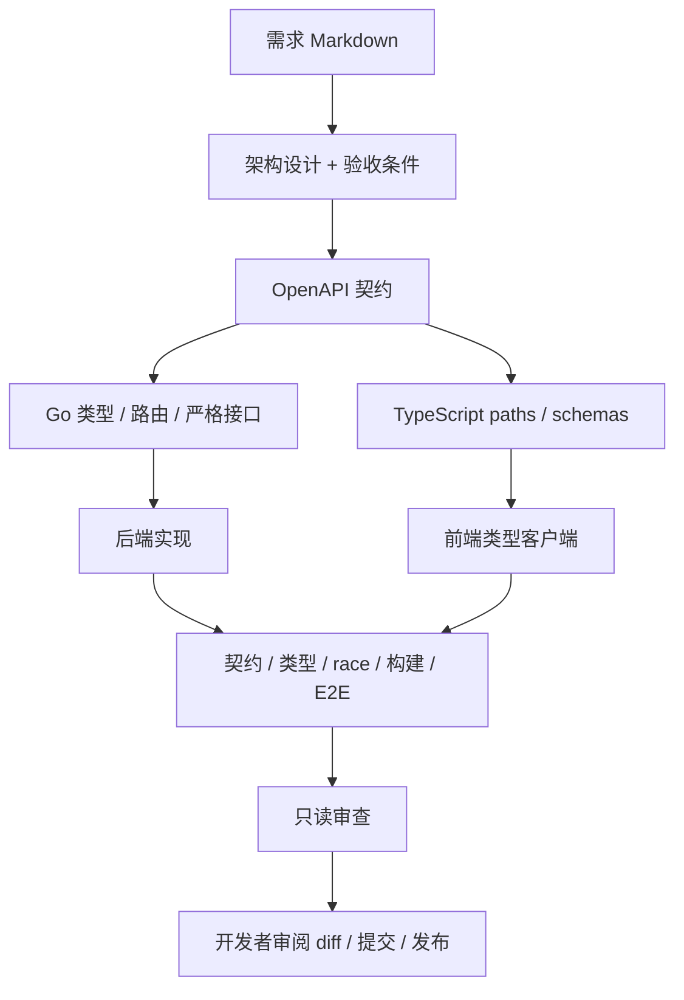

# 架构与工程决策

## 两条相互配合的链路

运行链路负责业务；开发链路负责从需求到可验证变更。AI 不在业务请求路径上，因此启动任务看板不依赖模型。




## 目录职责

```text
apps/web/src/app/          页面和交互
apps/web/src/lib/          API 客户端与生成类型
apps/api/cmd/server/       配置、启动和优雅关闭
apps/api/internal/api/     契约生成物，不手改
apps/api/internal/tasks/   业务处理器、文件 Store、测试
contracts/                OpenAPI 源文件
scripts/                  生成、开发进程管理、Agent 编排
specs/examples/           可直接执行的业务需求
.automation/roles/        编排器使用的角色指令
.codex/agents/            Codex 交互式角色配置
.agents/skills/           项目级可发现 Skills
.github/workflows/        作为独立仓库时生效的 CI
```

## 选型

| 层 | 当前实现 | 采用理由 |
|---|---|---|
| 前端 | Next.js App Router + React + TS | 页面与请求代理集中，类型检查覆盖调用参数 |
| API | Go net/http + oapi-codegen | 编译简单，严格服务端接口让契约改动显式影响实现 |
| 契约 | OpenAPI 3.0.3 | 同时生成两端代码，支持运行时校验 |
| 客户端 | openapi-typescript + openapi-fetch | 避免重复手写接口类型与请求包装 |
| 数据 | JSON + mutex + 临时文件 rename | 零基础设施启动，验证失败写入与恢复行为 |
| 联调 | Playwright + 真实 Go | 覆盖浏览器、Next rewrite、HTTP、持久化路径 |
| AI | Codex CLI + Python 标准库编排 | 复用本机登录、结构化结果、日志和超时控制 |

具体依赖版本由 package-lock.json、go.mod / go.sum 锁定；生成器在脚本中固定版本。

根 package.json 将 @typescript-eslint/typescript-estree 的 minimatch 限定覆盖为 11.0.5，处理上游仍依赖受影响 10.x 的情况；依据 [GHSA-g3hv-75wg-m249](https://github.com/advisories/GHSA-g3hv-75wg-m249)。这是局部工具依赖覆盖，升级 typescript-eslint 后应重新评估是否移除；本次通过 ESLint 与构建验证兼容性。

初次生成器下载仍需网络。Next.js rewrite 的机制依据[官方文档](https://nextjs.org/docs/app/api-reference/config/next-config-js/rewrites)，Go 严格接口依据 [oapi-codegen](https://github.com/oapi-codegen/oapi-codegen)。

## 前后端自动对接如何落地

1. 修改 `contracts/openapi.yaml`，定义 operationId、状态码和 Schema。
2. `npm run generate` 同时生成 Go 服务端和 TS 类型。
3. Go 编译器检查处理器是否实现接口；TS 检查前端路径、参数、body 与返回类型。
4. 请求进入 Go 时依据嵌入的契约校验；后端测试使用同一规范验证响应。
5. `npm run contracts:check` 在临时目录重生成并逐字节比较，不覆盖工作区文件，也不依赖 Git 是否已提交。
6. E2E 经过 Next 同源代理真实调用 Go，证明字段和行为实际匹配。

类型生成不能证明所有业务规则正确，所以还有标题空白规则、持久化回滚测试及真实浏览器交互测试。代理仅解决统一调用入口；有登录后仍应独立实现身份验证与授权。

## 数据一致性与限制

Store 的 mutex 保证同进程写入串行；先构造快照，写临时文件、sync、关闭、rename 成功后才更新内存。读接口返回复制切片，避免外部修改内部数据。启动加载已有文件，坏JSON、缺失必需字段、无效状态及重复ID均会使启动失败，避免静默覆盖。合法历史任务与原先支持的空快照行为保持兼容。

同一数据文件不支持多个后端进程、分布式锁或横向扩展；列表不分页。文件 sync + rename 也不等同于具备数据库事务和完整灾难恢复能力。开发 E2E 使用临时文件，业务数据放在 `.var/`；容器使用持久卷。

升级 PostgreSQL 时保持处理器和 OpenAPI 不变，把 Store 提取为小接口，使用迁移脚本和集成数据库测试替换文件实现。没有数据库需求时不引入 ORM、消息队列和微服务。

## Go 与 Rust 的取舍

默认 Go，便于在现有环境快速建立可运行闭环；本机没有 Rust 工具链。若团队已有 Rust 基础或明确需要其类型与内存模型，可保持同一 OpenAPI + TS 客户端，在 `apps/api-rust` 使用 Axum、Serde、SQLx，按规范实现一致的 operationId 路径、响应和校验。

迁移步骤：安装 Rust → 实现同一健康检查与 CRUD → 将现有 HTTP 契约用例复用到 Rust → 保持 8080 端口或修改 API_ORIGIN → 切换 CI 与镜像。Rust 方案目前是迁移设计，未包含已实现的第二套后端；不要同时维护两套相同业务服务。

## 本地运行与客户端恢复

开发脚本将端口解析、占用探测和限时健康检查封装在scripts/dev-runtime.mjs，使用真实本机端口及HTTP服务器回归，避免仅凭HTTP 200把未就绪服务当作后端。探测并非原子端口预留，服务启动错误仍由子进程退出触发整体停止。

前端初始读取与重试共享可取消的读取路径，响应版本号防止旧请求覆盖当前结果。写操作以返回的持久化结果更新本地列表，不再把写入与后续全量读取绑定为同一次成功条件。首次加载失败必须先恢复读取；提交中的草稿与操作被锁定，同一组件内的并发写被拦截。

客户端保护不提供跨客户端幂等或版本冲突检测。单进程JSON存储、无分页与无鉴权的边界保持原样。
